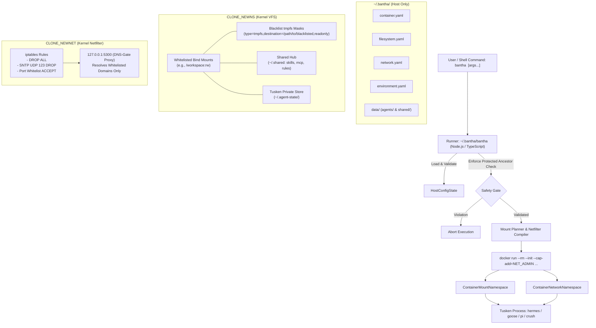

# System Architecture & Kernel Isolation (`bantha`)

This document explains the technical architecture of **Bantha** and how the Linux kernel guarantees hermetic isolation for both filesystem and network layers.

---

## 1. High-Level Architecture



---

## 2. Linux Kernel Virtual File System (VFS) Masking

### Why standard blacklist checking is insufficient
If a runner simply checks paths at startup and allows mounting a parent directory like `/workspace`, an agent process could walk the directory tree (`find /workspace` or `open("/workspace/private/key.pem")`) and access sensitive data.

### How Mount Masking Guarantees Isolation
Linux kernel mount namespaces (`CLONE_NEWNS`) allow mounting filesystems over existing paths:
1. Docker mounts the parent directory into the container.
2. The `agents` runner inspects the configured blacklist patterns and applies a dedicated mount:
   ```bash
   --mount type=tmpfs,destination=/workspace/private,readonly
   ```
3. When the container process calls `stat()`, `open()`, or `getdents64()` on `/workspace/private`, the Linux kernel resolves path resolution to the `tmpfs` mount point.
4. The underlying host files are completely shadowed and inaccessible. The process sees an empty directory, and any write attempts fail with `EROFS` (Read-only file system).

---

## 3. Netfilter & DNS Isolation

### Netfilter (iptables) in `CLONE_NEWNET`
Each container runs in its own network namespace. The entrypoint sets default packet drop policies:
```bash
iptables -P INPUT DROP
iptables -P FORWARD DROP
iptables -P OUTPUT DROP
```
All packets are rejected unless explicitly matched:
- **SNTP / NTP**: All outbound UDP packets to port 123 are explicitly dropped (`iptables -A OUTPUT -p udp --dport 123 -j DROP`).
- **Egress & Ingress**: Rules are created for configured IP addresses, CIDR blocks, and ports.

### Application-Layer DNS Gate
DNS resolution (UDP/TCP 53) is intercepted via NAT redirection:
```bash
iptables -t nat -A OUTPUT -p udp --dport 53 -j REDIRECT --to-ports 5300
```
An internal DNS gate daemon (`dns-gate.py`) inspects queries:
- Whitelisted domains are forwarded to authorized upstream DNS servers (e.g. `1.1.1.1`).
- Disallowed or blacklisted domains return `NXDOMAIN` immediately.
- Direct outbound DNS packets outside the gate are dropped by kernel netfilter rules.
