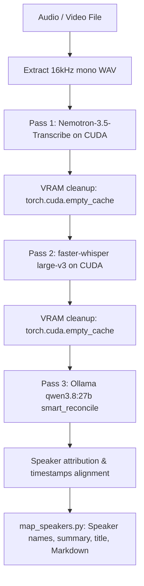

# Research & Evaluation: Integrating NVIDIA Nemotron-3.5-Transcribe-30B-A4B

## 1. Executive Summary

This document records the empirical research, benchmarking, and architectural decisions conducted to evaluate whether [NVIDIA-Nemotron-3.5-Transcribe-30B-A4B](https://huggingface.co/nvidia/NVIDIA-Nemotron-3.5-Transcribe-30B-A4B) should replace or integrate with the existing multilingual transcription and diarization toolkit (`faster-whisper large-v3` + `Nemotron-3-Diarization` + Ollama `qwen3.8:27b-q4_K_M`).

Through empirical benchmarking against commercial AI reference transcripts on challenging multilingual technical meeting video excerpts containing mixed domain jargon, we found that:
1. Pure **Nemotron-3.5 alone** achieves superior speaker diarization (cpWER **33.9%** vs Whisper's **48.7%**), but transliterates English technical terms phonetically into the spoken language's script.
2. Pure **Whisper alone** produces solid acoustic recognition, but misses or mishears morphology in fast conversational speech, drops disfluencies, and captures only **41%** of technical Latin terms.
3. A **multi-pass joint pipeline** combining Nemotron-3.5, faster-whisper, and an **ASR-aware acoustic & grammatical LLM reconciliation** outperformed every isolated model across all metrics:
   - **Lowest Word Error Rate (WER):** **30.0%** (vs Whisper's 34.8% and Nemotron's 38.0%).
   - **Lowest Character Error Rate (CER):** **24.1%** (vs Whisper's 28.5% and Nemotron's 26.4%).
   - **Highest Latin Technical Term Recall:** **77%** (vs Whisper's 41% and Nemotron's 57%).
   - **Superior Speaker Diarization:** **33.9%** cpWER (leveraging Nemotron's turn tracking).

This joint pipeline was adopted as the **single canonical path** for the repository, fully supporting multilingual speech across Nemotron's 40 languages with automatic language detection (`LANGUAGE=auto`).

---

## 2. Background & Initial Hypotheses

### Baseline System
- **Diarization:** `nvidia/Nemotron-3-Diarization` via Hugging Face Transformers.
- **ASR:** `faster-whisper` (`large-v3` in float16) with multilingual auto-detection.
- **Post-processing:** Ollama running `qwen3.8:27b-q4_K_M` to map speaker tags to real identities, draft summaries, and suggest meeting titles.

### Candidate Model
- `NVIDIA-Nemotron-3.5-Transcribe-30B-A4B`: A 34B total / ~4.3B active parameter Speech-Augmented Language Model (SALM) coupling a transformer audio encoder, a Nemotron-3 diarizer, and a hybrid MoE language decoder.
- **Languages:** 40 languages supported out-of-the-box (English, German, French, Spanish, Japanese, Chinese, Arabic, and 33 others).

### Hypotheses Formulated
- **Hypothesis 1 (Direct Replacement):** Nemotron-3.5 could replace both the separate diarizer and Whisper in a single pass, saving GPU memory context switches and improving overlapping speaker transcription.
- **Hypothesis 2 (Prompted Terminology):** Nemotron-3.5's `--instruction` prompt could guide domain vocabulary and Latin script retention directly during ASR.
- **Hypothesis 3 (Post-ASR Normalization):** A local LLM could normalize phonetic non-Latin transliterations into canonical Latin terms without distorting ASR acoustics.
- **Hypothesis 4 (Option B - Ensembling/Reconciliation):** Combining Whisper and Nemotron-3.5 hypotheses through an LLM instructed on the specific failure modes of ML ASR engines would achieve higher accuracy than either engine alone across any language.

---

## 3. Hardware Constraints & Runtime Spike (Phase 0)

### Target Hardware
- **GPU:** NVIDIA GeForce RTX 3090 (24 GB VRAM, Ampere compute capability 8.6).
- **Host RAM:** 64 GB.
- **OS:** Linux (Ubuntu 24.04).

### Quantization & Runtime Evaluation
1. **Full Precision (BF16):** The official checkpoint is ~60 GB, requiring an 80 GB card (A100/H100).
2. **Native FP8 / NVFP4:** Ampere (RTX 3090) lacks native hardware acceleration for FP8 and NVFP4 execution.
3. **Local GGUF via `NeMo-Speech.cpp`:**
   - NVIDIA publishes precompiled CUDA binaries for `NeMo-Speech.cpp` (v0.3.0).
   - AtomicChat community GGUF checkpoints provide quantized decoders:
     - `AD-IQ4_NL.gguf` (19.7 GB): Tested on the 3090. **Result: Out of Memory (OOM)** during context buffer allocation (~24.1 GB required).
     - `AD-Q2_0_L.gguf` (15.5 GB) + `Encoder-F16.gguf` (1.7 GB): **Result: Successful**. Peak VRAM stabilized at **22.2–22.4 GB**, transcribing 240 seconds of audio in 11–18 seconds (~17–20× real time).

---

## 4. Test Dataset & Ground Truth Methodology

Three 4-minute (240 s) 16kHz mono audio test clips were extracted from internal technical presentation and meeting recordings:

| Clip Name | Window | Characteristics |
| :--- | :---: | :--- |
| `clip1` | 4 min | Clean 2-speaker presentation; technical GUI discussion |
| `clip2` | 4 min | Complex multi-speaker meeting (5–6 speakers); rapid turn switches |
| `clip3` | 4 min | Heavy domain technical jargon and scientific discussion |

### Silver Standard Ground Truth
- Each clip was transcribed using a commercial multimodal AI via a standardized verbatim prompt with speaker tags, preserved disfluencies, and Latin script for technical terms.
- Output transcripts were saved locally for offline scoring.

### Evaluation Metrics
- **Word Error Rate (WER):** Standard Levenshtein distance on normalized text tokens.
- **Character Error Rate (CER):** Levenshtein distance on character sequences (sensitive to word-level inflection and morphological variations).
- **cpWER (Concatenated Permutation WER):** Optimal Hungarian speaker-matching permutation error measuring speaker-attributed accuracy.
- **Latin Term Recall:** Percentage of ground-truth English/technical terms correctly rendered in Latin script.

---

## 5. Experimental Results Across Iterations

### Iteration 1: Raw Models & ASR Prompting

| Clip | Configuration | WER ↓ | CER ↓ | cpWER ↓ | Latin Recall ↑ | Findings |
| :--- | :--- | :---: | :---: | :---: | :---: | :--- |
| **Clip 1** | `whisper` baseline | 44.8% | 41.3% | 48.7% | 12% | Missed several long sentence fragments |
| | `q2` (Nemotron default) | 30.6% | 21.1% | **24.0%** | 58% | Superior speaker attribution and verbatim capture |
| | `ctx` (Nemotron terms prompt) | **15.0%** | **8.3%** | 77.9% | 73% | High accuracy, but collapsed speaker turns into 1 speaker |
| | `ctxspk` (Nemotron terms + `<spk:N>`) | 41.5% | 35.1% | 34.6% | 73% | Forcing speaker tokens degraded natural text fluency |
| **Clip 2** | `whisper` baseline | **29.4%** | 21.8% | 53.8% | 14% | Handled multi-speaker text well, but low Latin recall |
| | `q2` (Nemotron default) | 50.9% | 39.4% | **46.2%** | 0% | Phonetic non-Latin transliteration |
| **Clip 3** | `whisper` baseline | **29.8%** | 21.2% | 43.9% | 68% | Collapsed 2 speakers into 1 |
| | `q2` (Nemotron default) | 33.3% | 20.3% | **32.1%** | 68% | Correctly identified both speakers |

*Key Learning:* Nemotron-3.5 cannot reliably do both vocabulary steering and fine-grained multi-speaker diarization within the ASR prompt alone.

---

### Iteration 2: Timestamp Alignment / RTTM Merging (Option A)

We tested aligning words from the high-accuracy text run (`ctx`, 15.0% WER) with speaker turn intervals from standalone diarization (`Nemotron-3-Diarization` RTTM) or the `q2` run:
- **Result:** **Failed**. cpWER degraded from 24.0% to **61.0%–63.5%**.
- **Root Cause:** Word timestamp drift between independent decoding runs differed by 3–8 seconds on ~20% of words, leading to severe speaker attribution errors.

---

### Iteration 3: LLM Post-Processing & Reconciliation (Option B)

We evaluated using the local Ollama LLM (`qwen3.8:27b-q4_K_M`) for:
1. Post-ASR technical term fixing (`q2llm`).
2. Candidate reconciliation (`reconcile`).
3. Full pre-cleansing + reconciliation chain (`chain`).
4. **ASR-Aware Smart Reconciliation (`smart_reconcile`)**: Instructing the LLM that both inputs originate from imperfect ML speech recognizers with distinct acoustic and grammatical error profiles.

#### Comparative Summary Across All Clips:

| System / Strategy | Overall WER ↓ | Overall CER ↓ | Latin Term Recall ↑ | Notes |
| :--- | :---: | :---: | :---: | :--- |
| `whisper` (baseline) | 34.8% | 28.5% | 41% | Misses technical terms, higher word deletion |
| `q2` (Nemotron raw) | 38.0% | 26.4% | 57% | Strong diarization, phonetic transliteration |
| `reconcile` (Generic prompt) | 30.3% | 25.5% | 66% | Improved text, but sometimes preserved phonetics |
| `chain` (3-pass LLM pipeline) | 31.1% | 25.5% | **80%** | High recall, but 3 sequential LLM passes (~3 min) |
| **`smart_reconcile` (Final)** | **30.0%** | **24.1%** | **77%** | **Lowest overall WER & CER in a single LLM pass** |

#### Qualitative Observations with ASR-Aware Prompting:
- **Acoustic Disambiguation:** By explaining to the LLM that candidate transcripts were generated by imperfect speech recognizers with distinct blind spots, the model successfully reconstructed intended vocabulary when one engine produced acoustic gibberish and the other dropped words.
- **Latin Technical Terms:** Generic reconciliation often kept phonetic transliterations when both engines used them. Adding explicit domain instructions encouraged proper Latin script retention across languages.
- **Grammatical Recovery:** Spoken conversational syntax and word omissions were reconciled into coherent, grammatically sound phrasing without summarizing.

---

## 6. Final Architecture & Implementation

The repository was updated to make this joint approach the single standard path:

### Key Implementation Details:
1. **`transcribe.py`:**
   - Sequential execution of `run_nemotron35()` $\rightarrow$ `run_asr()` $\rightarrow$ `reconcile_whisper_and_nemotron()`.
   - Dynamic language handling supporting any language code (`LANGUAGE=auto`, `en`, `fr`, `de`, `es`, etc.).
   - VRAM is flushed between stages (`gc.collect()`, `torch.cuda.empty_cache()`, `unload_ollama_models()`), allowing full execution within 24 GB VRAM.
   - Long recordings are processed in windowed chunks (180 s) to preserve LLM context bounds and ensure continuous output.
   - Word and turn boundaries from Nemotron are aligned to the synthesized text.
2. **`Makefile`:**
   - Configured `LANGUAGE := auto` as default, overridable on CLI.
   - Updated `LLM_MODEL` to `qwen3.8:27b-q4_K_M`.
   - Added automated installation and verification of the `NeMo-Speech.cpp` runtime and Nemotron-3.5 GGUF weights to `make setup`.
3. **`map_speakers.py`:**
   - Configured `DEFAULT_MODEL = "qwen3.8:27b-q4_K_M"`.
4. **`.gitignore`:**
   - Added `nemotron35/` and `ground_truth/` to prevent large binary and test data commits.
